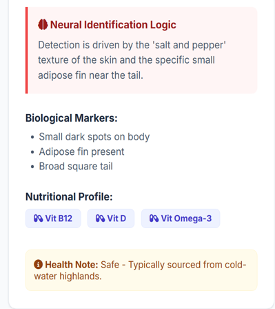

#  FishGuard AI

### AI-Based Fish Species and Freshness Classification System
Main Dashboard

FishGuard AI is an academic project that explores the use of Artificial Intelligence and Deep Learning for fish species identification and freshness classification through image analysis.

        Project Overview
  

  <em>Fish Species Identification & Fish Freshness Detection</em>

The project uses computer vision techniques to analyse fish images and provide predictions about fish species and freshness.

###  Key Features
- Fish species classification
- Fish freshness detection
- Image-based prediction
- Separate deep learning models for classification tasks

###  Technologies Used
- Python
- TensorFlow
- Keras
- MobileNetV2
- Flask
- SQLite
## ⚙️ How It Works

FishGuard AI uses two separate deep learning models to perform image-based classification.

### 🐟 1. Fish Species Classification
- Accepts an uploaded fish image.
- Processes the image using a MobileNetV2-based model.
- Predicts the fish species.

### 🔍 2. Fish Freshness Classification
- Accepts a fish image.
- Analyses the image using a separate trained model.
- Predicts the freshness category.

###  Project Purpose

To explore how AI and computer vision can be applied to fish identification and freshness assessment.

###  Source Code

The source code and implementation files are not publicly available in this repository.

###  Project

Developed as part of my academic project work.
